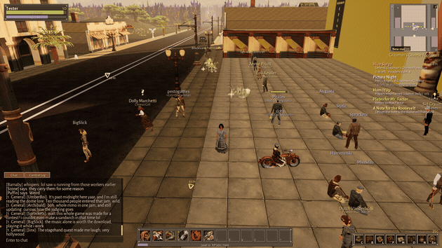
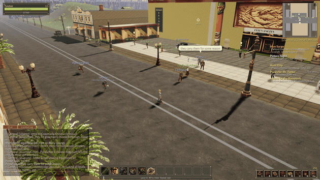
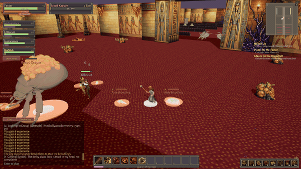
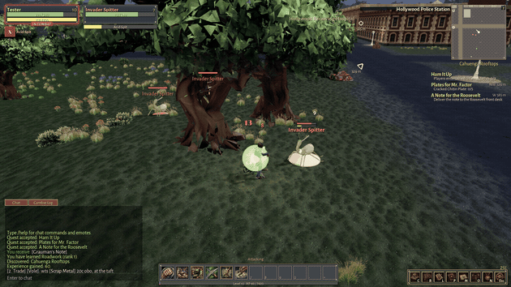
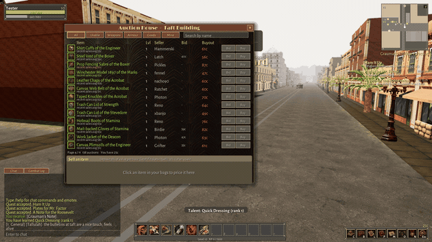
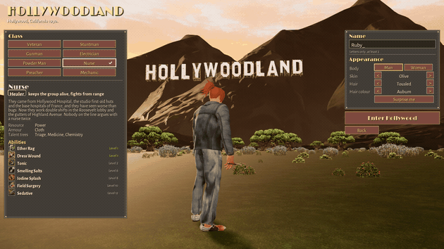

# Hollywoodland: The MMO

**A full-featured, open-source MMORPG built on Unreal Engine 5.9, playable in your browser.**

*Can two dudes with $20-a-month AI subscriptions make a full-featured MMO in four days?* This is our answer.

**Play it on itch.io: [coeurnix.itch.io/hollywoodland](https://coeurnix.itch.io/hollywoodland)**

| | |
|---|---|
|  |  |
|  |  |
|  |  |

## The story

Hollywood, California, 1930. The pictures have just learned to talk, the HOLLYWOODLAND sign glows on the hill above the
boulevard, and the town has just been sealed under a shimmering dome. Something came down with it: giant insect invaders
that tunnel up through the alleys, nest in the hotels, and hive in the old Egyptian Theatre. The studios, the shopkeepers
and the stunt crews are holding the boulevard together with shovels, six-shooters and nerve.

Pick a trade (Veteran, Stuntman, Gunman, Electrician, Powder Man, Nurse, Preacher or Mechanic), step onto Grauman's
Chinese forecourt, and help take Hollywood back, one reel at a time.

## What's in it

- **A big, living world:** Hollywood Boulevard from Grauman's Chinese to Vine Street, the Roosevelt and the Hollywood
  Hotel, the bank, the Brown Derby, Franklin Slopes, the Selma alleys, Hollywood High, the police station, the Pacific
  Electric red car line, and the hive wall at the edge of the dome. A day and night cycle runs over all of it.
- **A town full of players:** hundreds of players call Hollywoodland home, out on the boulevard at any moment, questing,
  trading, chatting, dancing on the bank steps and getting in each other's way.
- **Eight classes, 61 abilities and 384 talents** across three talent trees each, with trainers, ranks and respecs.
- **Quest chains everywhere:** a guided nine-reel opening, then quests across branching chains, with voiced quest givers
  (569 voice lines).
- **Dungeons:** like the Egyptian Theatre, a five-player hive crawl with four bosses, from the Brood Keeper to the Hive Mother.
- **A connected social economy:** an auction house with bids and buyouts, player trading, C.O.D. mail, a bank, vendors,
  repairs, professions and a workbench, and nearly 4,000 items to find, craft, sell and wear.
- **A huge social experience:** parties and group finding, guilds that recruit, friends and rivals, duels, zone, trade,
  looking-for-group and guild chat, whispers, and a full set of emotes.
- **Custom appearances:** men and women in many skin tones, hairstyles and colours, and 33 period outfits from newsboy caps
  and suspenders to tuxedos, gowns and steel cuirasses, all worn piece by piece as you gear up.
- **World events:** hive surges that besiege a hub until the town drives them off, picture night on the forecourt, rare
  spawns, and the odd conga line.
- **Mounts:** a horse, an Indian Scout motorcycle and a Model A, plus the red car for when you'd rather ride.

## How it was made

Two humans, [Coeurnix](https://coeurnix.itch.io) and [Mr. Coconut](https://mistercoconut.itch.io/), made this during
the Epic AI MegaJam. The whole game was designed and coded through human-guided LLM agents. Everything other than the
engine and the MakeHuman base models was created specifically for this game.

**The agents**

- **Anthropic's Fable 5.2:** high-level planning and the first pass at the large, complex systems
- **Anthropic's Opus 5.5:** most of the coding, and some asset creation
- **OpenAI's Astra 6:** game testing
- **OpenAI's Sol 6.1:** game testing and 3D model creation

**The assets**

- **3D models and animation:** Hyper3D Rodin and agent-controlled Blender with MakeHuman, with some texturing and
  reference images from FLUX 3 Klein (via fal.ai) and GPT Image 2.6
- **Sound effects:** ElevenLabs SFX v3 (via fal.ai)
- **Music:** Google's Lyria 3 Pro (via fal.ai)
- **Voice acting:** ElevenLabs Eleven v4 (via fal.ai)
- **Images:** FLUX 3 Klein (via fal.ai) and a few GPT Image 2.6 images

**The server** runs on Cloudflare as a Worker. Getting a full Unreal Engine game talking to it from a browser took a few
modifications to the engine's web build; they are documented below under *Engine/web constraints*.

<details>
<summary><b>■ Spoiler (click to reveal)</b></summary>

Every other player in Hollywoodland is simulated, all 300 of them. The simulation is likely the most complex thing in the game.

**They are people, not mobs.** Each one has a handle, a home country (24 of them), a time zone and a schedule for when
they log on and off, a first language and an English level, and a typing style: some type in all lowercase, some never
use punctuation, some write essays. Each has one of 18 personality archetypes, from the confused newbie and the
min-maxer to the Leeroy, the trader, the lore nerd, the drama magnet, the backseat raid leader, the silent pro and the mum
playing after the kids are asleep. They have traits (sociability, patience, humour, aggression, curiosity) that shape
everything they do. They know it's 2026, they know this started as a jam game, and they have opinions about the news.

**Each one has a mind, a motor and a body** (`HLMind.cpp`, `HLMotor.cpp`, `HLSim.cpp`; design in `AI-IMPROVEMENTS-PLAN.md`).

- **The mind** keeps an agenda of goals: quest, grind a camp, sell, train, bank, auction, rest, explore a landmark,
  socialise, group up for the Egyptian, help someone, watch an event, show off, go AFK, log off. Every second or two,
  each goal is scored locally by need, personality and opportunity, minus the cost of switching. Goals have commitment
  and are suspended rather than dropped, so a player who was selling before a fight goes back to selling after it.
- **When the choice is hard** (two goals close, something unusual happening, the player asking for help), the game builds
  a situation report in code: their level, health, bags, money, mood, what they're doing and why, and three or four
  costed options with risks attached. A language model then makes the in-character judgment between options the code
  computed, and can only pick from that list. For background players, a cheaper structured decision samples the choice
  from the model's probabilities over the option IDs. If a call is slow or fails, local utility carries on without it.
- **The motor** turns intent into imperfect, human input. Each player sees the world through a snapshot that refreshes
  every quarter second to a second and a bit, depending on attention and skill. They react late, overshoot and correct,
  press abilities with human timing, kite badly or well, and stand still while they type, for exactly as long as their
  typing speed takes.
- **The body** is the same unit the real player has: the same pathing, abilities, cooldowns, threat and loot rules.
  Nobody cheats.

**Detail follows attention.** Players in your party, talking to you or within about 25 metres get the full mind, with
model calls for replies, observations, plans and party chat. Other visible players run on local utility and the motor
layer. The census off-screen keeps levelling, grouping and gossiping in summary.

**They remember you.** Each player keeps a relationship with you: liking, familiarity, the last lines you exchanged, and
episodes ("healed me through a bad pull", "saw them dancing on the bank steps", "we wiped in the Egyptian"). Those
memories fade over real days unless refreshed. Bonds and rivalries form. A friend logs on and says hi, and a rival
remembers the duel.

**They talk like players.** General chat mixes a hand-written corpus of more than 1,500 lines and dozens of multi-player
conversations with live replies from language models. Every reply comes from a persona card, the facts that persona would
actually know about the world (pulled through world tools, half-remembered or wrong where that persona would be wrong),
and the decision the game has already made. The words have to match the decision. Ask whether they're a bot and each one
has a stance: dodge it, deny it while eating cereal, or cheerfully admit it.

**Their words are kept.** If someone offers to group, the invite arrives. If they say "omw", they walk over. If they say
"follow me to the bank", they lead you there and wait when you fall behind. If they say they'll accept, they accept.

**They are the economy and the events.** They list and bid on the auction house, sell to vendors, recruit for guilds,
challenge strangers to duels, rally when a hive surge hits a hub, find seats for picture night, start conga lines and run
circles in the street when they're bored. The party you take into the Egyptian is four of them, each with a role,
beliefs about the group, patience that wears thin after a wipe, and a voice in party chat.

The town you walk into is a few hundred minds, each deciding what to do next. Say hi. Someone will probably answer.

</details>

## License

MIT (see `LICENSE`). Credits for the third-party MakeHuman assets (CC0 and CC-BY) are in `CHARACTERS-V2.md` and
`art/characters_v2/LICENSES.md`.

## Thank you

Huge thanks to **Epic Games** for sponsoring and hosting the **Epic AI MegaJam**, and to everyone who stops by the boulevard.

---

# For developers

Single-player client: UE 5.9.0 Preview (source build) → WebAssembly/WebGPU, hosted on itch.io; every other player is
simulated locally, with language-model calls through the API server, a Cloudflare Worker.
Design reference: `DESIGN-BIBLE.md`. Roadmap and status: `PLAN.md`. Simulated players: `AI-IMPROVEMENTS-PLAN.md`.
Assets: `ASSETS.md`, `CHARACTERS-V2.md`.

- Server API: https://hollywoodland-server.coeurnix.workers.dev/

## Layout

| Path | What |
|---|---|
| `hollywoodland-ue/` | UE project. All gameplay is C++ + Slate in `Source/Hollywoodland`; the world is built procedurally from `Content/Data/*.json`. |
| `tools/gen-data.mjs`, `tools/gen/` | Content generator → `hollywoodland-ue/Content/Data/*.json` (items, mobs, zone layout, quests, personas, chat). |
| `workers/server/` | `hollywoodland-server` Worker: sessions, `/v1/sim` (simulated-player decisions and chat; Fireworks and OpenAI, each the other's fallback), cloud saves (KV). |
| `workers/client/` | `hollywoodland` Worker: serves a packaged Wasm stage from R2 with COOP/COEP, Brotli siblings and Range (the pre-itch host). |
| `tools/itch/` | itch.io package: `package.mjs` (stage + music + bundled sfx, limit checks), `audiopack.mjs`. |
| `tools/charv2/` | Characters v2: MakeHuman/MPFB bodies, wardrobe fitting, FLUX repaints, hats, coverage-based zone hiding, `make_json.py` → `characters_v2.json`. |
| `tools/propprep.py`, `tools/buildprep.py` | Stage the Rodin props and the building kit for import (`Scripts/ImportProps.ps1`, `Scripts/ImportBuildings.ps1`). |
| `tools/titlegen.py` | The character-select backdrop: the Rodin ridge and the FLUX sunset sky. |
| `tools/zfight.py`, `tools/zfight_batch.py` | Find and fix coplanar overlapping faces (flicker) in building meshes. |
| `tools/capture/` | In-engine frame capture (`shoot.sh`) and itch GIFs (`gif.sh`); `itch/` holds the screenshots and the page description. |
| `tools/maps/` | Painted maps: `source_maps.py` (layout sources), `paint_maps.py`, `install_maps.py` (check + install). |

Large local-only material (character masters and exports, the imported `Content/CharactersV2` assets, raw Rodin GLBs)
is listed in `.gitignore`; the pipelines above rebuild it.

## Build and deploy

```powershell
node tools/gen-data.mjs                                   # regenerate Content/Data (deterministic)
hollywoodland-ue\Scripts\BuildWeb.ps1                      # editor + Wasm Shipping build, cook, package -> web-dist-Shipping\Wasm (~8 min cold)
node tools/itch/package.mjs                                # itch stage (checks < 500 MiB, < 1,000 files)
butler push hollywoodland-ue/web-dist-Shipping/itch coeurnix/hollywoodland:html5 --userversion <v>
cd workers/server; npx wrangler deploy                    # API worker (secrets: FIREWORKS_API_KEY, OPENAI_API_KEY, SESSION_SECRET)
```

itch page settings: HTML, "This file will be played in the browser", 1600×900 with the fullscreen button,
Embed options → SharedArrayBuffer support.

Windows standalone: `hollywoodland-ue\Scripts\BuildWindows.ps1` → `win-dist-Development\Windows\Hollywoodland.exe`.
Native test run without packaging (fastest iteration, same code): `hollywoodland-ue\Scripts\BuildEditor.ps1`, then
`hollywoodland-ue\Scripts\RunNative.ps1 -HLAuto=<class> [-HLAutoDungeon] -HLAutoQuit=<seconds>` (self-playing smoke test;
`HL_STATUS` lines in `Saved\Logs\Hollywoodland.log`, screenshots in `Saved\Screenshots`). Other self-play flags:
`-HLTourTest`, `-HLViews -HLViewSet=drag|forecourt|landmarks|nature|show|crowd`, `-HLLineup`, `-HLEventsSoon`,
`-HLOpen<Window>`. Trailer capture: `bash tools/capture/shoot.sh <name> <start_s> <frames> <flags>` then
`bash tools/capture/gif.sh <name>`.
Browser tests (Playwright): `tools/probe.py <url> --auto veteran` (self-play via `localStorage hl_auto`),
`tools/probe-input.py <url> <out-prefix>` (real keyboard/mouse). Server: `node tools/test-server.mjs`;
simulated-player evals: `node tools/ai-eval.mjs`.

## Engine/web constraints that shaped the code (do not rediscover)

- `FHttpModule` is null on Wasm and the game thread never yields to JS: all HTTP/localStorage goes through `HLBridge` (EM_JS on the
  browser main thread via `emscripten_proxy_async`, results polled each tick). Pointers cross as `double` (wasm64).
- Shipping web builds have no `UE_LOG`; use `HLBridge::Log` (console.log).
- Quote URLs in ini files. `FTickableGameObject` CDOs tick unless excluded.
- No authored map/Blueprint assets: the cook only needs `/Engine/Maps/Entry`, `/Engine/BasicShapes`, `/Game/HL` (materials made by
  `Scripts/make_assets.py`) and `Content/Data` (staged as UFS).
- Wasm target uses the `WebMinimal` trim profile: no nav mesh (own grid A*), no StateTree, no ICU. Cook must pass
  `-DisablePlugins=AllToolsets,Terminal,UnrealCanvasBridge`.
- Hosting needs COOP/COEP (itch: SharedArrayBuffer support), raw 206 ranges, and on R2 files > 25 MiB with `.br` siblings and
  `encodeBody: 'manual'`.
