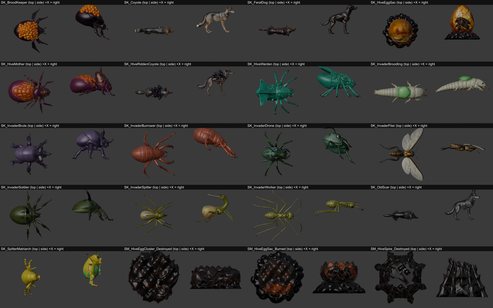

# art/enemies: enemy models and animations (not yet integrated)

This folder holds rigged, animated enemy models for every mob that can appear in the built slice: Hollywood Boulevard, its hive-wall gaps, and the Egyptian Theatre dungeon. It also holds burned or destroyed versions of the hive structures players break.

**Nothing in `hollywoodland-ue/` has been changed.** Integration is a separate job; this README is written for the agent who does it. `enemies.json` is the machine-readable source of truth. Read it before anything else.



## 1. What's here

```
art/enemies/
  enemies.json              mob id -> model, texture variant, scale, clip per role, event frames  (generated by tools/manifest.py)
  <Model>/SK_<Model>.fbx    skeletal mesh + every animation (Unreal import)
  <Model>/SK_<Model>.glb    the same with textures embedded (preview / three.js / model-viewer)
  <Model>/textures/         T_<Model>_BaseColor.png (sRGB), _Normal.png, _MetallicRoughness.png, plus variant base colours
  <Model>/<Model>.rig.json  bones, clip lengths, size, triangle count
  HiveStructures/           SM_* static meshes: burned egg sac, destroyed egg cluster, snapped hive spire (+ textures)
  previews/roster.png       top and side view of every model (+X is right in both)
  tools/                    the scripts that made all of this (section 8)
```

17 skeletal models, 3 destroyed-state static meshes, 3 colour variants. 93 MB in total. Each model is 9,000 triangles (the broodling is 5,000), with three 1024² textures.

## 2. Which enemy uses which model

Every mob in `Content/Data/mobs.json` is placed in `areas.json` (`zone_hollywood_blvd` or `dng_egyptian`). The hive surge in `HLEvents.cpp` spawns from the same five invader templates (worker, drone, spitter, broodling, soldier), so it needs no extra models.

| Model | Mobs (mobs.json id → texture) | In game | Special clips |
|---|---|---|---|
| InvaderWorker | `mob_invader_worker` | Franklin slopes, forecourt (q_hb_01) | flees at 30% → `Run` |
| InvaderDrone | `mob_invader_drone`, `mob_invader_drone_hs`, `mob_egy_drone` (Theatre Drone, elite) | alleys, Hollywood High gates, Egyptian, Hive Mother adds | — |
| InvaderSpitter | `mob_invader_spitter`, `mob_egy_spitter` (Balcony Spitter, elite) | Cahuenga rooftops, Egyptian balcony | `Spit` (ab_mob_acid_spit) |
| InvaderSoldier | `mob_invader_soldier`, `mob_egy_soldier` → base · `mob_guard_cahuenga`, `mob_pass_soldier` → **Hardened** · `mob_wall_stalker` → **WallStalker** | school field, Egyptian stage, Highland-north gap, hive walls | `Charge` |
| InvaderBroodling | `mob_invader_broodling`, `mob_egy_broodling` | schoolyard swarms, Egyptian aisles, Brood Keeper eggs | `Hatch`, `Leap` |
| InvaderBurrower | `mob_selma_burrower` (rare, "The Selma Avenue Burrower") | Selma Ave | `Burrow`, `BurrowedIdle`, `Emerge` |
| InvaderFlier | `mob_pass_flier` (Hardened Invader Flier, elite) | Highland-north gap | `FlyIdle`, `FlyForward`, `Dive` (script flier), `Sting` |
| InvaderBrute | `mob_ballroom_brute` (q_hb_24), `mob_guard_gower`, `mob_guard_melrose`, `mob_melrose_brute` | Hollywood Hotel ballroom, east/south gaps | `Slam` (ab_mob_knockback) |
| BroodKeeper | `mob_boss_brood_keeper` (boss 1) | Egyptian | `Slam` |
| HiveWarden | `mob_boss_hive_warden` (boss 2) | Egyptian | `Charge` (ab_mob_charge, every 15 s) |
| SpitterMatriarch | `mob_boss_matriarch` (boss 3) | Egyptian | `Spit`, `SpitPool` (ab_mob_acid_pool) |
| HiveMother | `mob_boss_hive_mother` (final boss) | Egyptian stage | `Summon` (calls 4 Drones at 66% / 33%), `Slam` |
| Coyote | `mob_coyote` | Franklin slopes | `Howl` |
| OldScar | `mob_old_scar` (rare, "Big grey brute") | Franklin, east end (q_hb_09) | `Howl` |
| HiveRiddenCoyote | `mob_gulch_coyote` ("Hive-ridden Coyote", design §7) | Boulevard zone, level 18–20 camp | `Howl` |
| FeralDog | `mob_feral_dog` | Franklin (q_hb_04) | — |
| HiveEggSac | the "Egg Sac" object in the Hive Mother fight (areas.json) | Egyptian stage | `Pulse`, `SacHit`; burned state in HiveStructures |
| *(none)* | `mob_looter`, `mob_looter_ringleader` (Knuckles Malone), `mob_guard_la_brea` (Dragna Enforcer), `mob_wh_gunman` (Dragna Gunman) | streets, west gap | humans: already drawn by the character system (`FHLChars::LookFor`) |

Where the looks came from:
- **Design bible:** §3 (insects 1–4 m, a hive), §7 (families, ranks, Hive-ridden), §14 (boss mechanics).
- **Dialogue and quests:**
  - "a beetle the size of a Ford"
  - "six-foot beetle"
  - broodlings "the size of a cocker spaniel" with venom sacs
  - Soldiers "plated up like a Packard", with mandibles
  - compound eyes, antennae and stingers
  - a "queen of some kind" on the Egyptian stage, which is why the Hive Mother has scarab markings
  - Old Scar is a "big grey brute"
- **Colours:** from `mobs.json` `color`.

### Elite, rare and boss variation

The data already gives each rank its own `scale`, and the model's size multiplies by it. Theatre elites use the same mesh and colour as their family; that matches their data colour. Only the Hardened soldier and the Wall Stalker differ in colour, so they get the two variant textures. The four bosses, Old Scar and the Hive-ridden coyote each have a model of their own.

## 3. Conventions (read before importing)

| What | Value |
|---|---|
| Forward | **+X** (head). Up +Z. Pivot on the ground under the body centre. The head goes at +X, like the cone "head" in `AHLWorldActor::BuildUnit`. |
| Scale contract | At actor scale 1.0 a model is `size_m_at_scale_1` in `enemies.json`: invaders are 2.0 m long (the Matriarch is 1.1 m long, 2.2 m tall), and quadrupeds are 1.6 m nose to tail tip. **Multiply by the mob's `scale` from mobs.json and nothing else.** The current placeholder already does that (`A->SetActorScale3D`-style `S`). In game: broodling 0.9 m, worker 1.6 m, drone 2 m, soldier 2.5 m, brute 3.8 m, Hive Mother 5.2 m, coyote 1.36 m. |
| FBX | Binary FBX 7.4 from Blender 5.1, exported **exactly like `tools/propprep_blender.py`**: `apply_unit_scale=True`, `apply_scale_options='FBX_SCALE_UNITS'`, default axes, `path_mode='STRIP'`, no embedded textures, `add_leaf_bones=False`, deform bones only. The armature object is named `Armature`, so Unreal drops it and the skeleton root is the bone `root`. |
| Bones | `root` (non-deforming, at the origin) → body bones → limbs. Insects: `thorax`, `head`, `abdomen`, `leg_{L,R}{1,2,3}_{upper,lower}` (1 = front), plus `wing_{L,R}_{1,2}` (Flier). Quadrupeds: `pelvis`, `chest`, `neck`, `head`, `tail_1/2`, `leg_{F,H}{L,R}_{upper,lower,foot}`. Egg sac: `sac`. The full list is in each `rig.json`. |
| Animations | One FBX take per clip, named `A_<Model>_<Clip>`, at 30 fps. Everything is **in place**: the game moves the actor and the clips never translate it. Loops are seamless. Event frames, such as when a hit lands, are in `enemies.json` → `models.<M>.clips.<C>.events`. |
| Textures | glTF PBR. BaseColor is sRGB. `MetallicRoughness` follows the glTF packing: roughness in **G**, metal in **B** (the same as the props, so `M_HLWorldProp`'s MR path fits it). Normal maps are in the glTF/OpenGL convention (+Y), so **tick Flip Green Channel** when importing them in Unreal. |
| Budget | 9k triangles and 3×1024² textures per model; the broodling has 5k. The worst-case scene is a Hive Mother fight with 4 summoned Drones, about 45k triangles. Generate LODs as the props do (LOD1 50%, LOD2 25%). |

## 4. Suggested Unreal import (mirror the props pipeline)

`hollywoodland-ue/Scripts/import_props.py` + `ImportProps.ps1` are the model to follow. A new `import_enemies.py` would do this:

1. **Textures.**
   - Import every PNG under `art/enemies/*/textures` and `HiveStructures/textures` into `/Game/Enemies/<Model>/`.
   - Normal maps: `srgb=False`, `TC_NORMALMAP`, **`flip_green_channel=True`**.
   - MetallicRoughness: `srgb=False`, `TC_MASKS`.
2. **Skeletal meshes.** Use `unreal.FbxImportUI` with these settings:
   - `import_as_skeletal=True`, `mesh_type_to_import=FBXIT_SKELETAL_MESH`
   - `import_materials=False`, `import_textures=False`, `import_animations=True`
   - The props' transform on **both** `skeletal_mesh_import_data` **and** `anim_sequence_import_data`: `import_uniform_scale=100.0` and `import_rotation=Rotator(yaw=-90)`. The props needed exactly this to land at 1 unit = 1 cm with the front at +X.
   - Then **check that the head of `SK_InvaderDrone` points to +X in the editor.** If it doesn't, adjust the yaw once for all models, since they all share one convention.
3. **Animation names.** Unreal names the takes `<Mesh>_Anim_A_<Model>_<Clip>` or similar. Rename them to `A_<Model>_<Clip>` so they match `enemies.json`.
4. **Materials.**
   - Make one `MI_<Model>` per model on a master with BaseColor, Normal and MR. This is `M_HLWorldProp` with **Used with Skeletal Mesh** enabled, or a copy of it.
   - Make variant instances `MI_InvaderSoldier_Hardened` and `MI_InvaderSoldier_WallStalker`, which swap only the BaseColor.
5. **Static meshes.** Import `HiveStructures/SM_*.fbx` with the prop static options into `/Game/Enemies/HiveStructures`.
6. **Cooking.** Make sure `/Game/Enemies` is always cooked, as `/Game/Props` is.

## 5. Code integration points (for reference only, not changed)

These are the places in the current code that would consume the assets:

- **`AHLWorldActor::BuildUnit`** (`HLWorldActor.cpp`, `Shape == "bug"` / `"quad"`): replace the sphere/cone and box placeholders with a `USkeletalMeshComponent`. Pick the mesh and material by mob id through `enemies.json` → `mobs.<id>.model` / `base_color`. Keep `A->SetActorScale3D(FVector(U.Scale))`, or the current per-component `S`, as the only scale.
- **`AHLWorldActor::SyncUnits`**: drive the clips from unit state.

  | Unit state | Clip |
  |---|---|
  | Standing still | `roles.idle` |
  | Moving | `walk` or `run` by speed (`mobs.json speed`) |
  | Each swing | `attack`; apply the hit at `events.hit` if the visuals should line up |
  | Taking damage | `hit` |
  | `bDead` | `death`, then hold the last frame as the corpse (the "destroyed" state) |

  **Remove the 90° roll** on dead non-humans (`FRotator(0, U->Yaw, U->bDead && !V->bHuman ? 90 : 0)`) and the dead-colour darkening, because the death clips now do this.
- **Burrower** (`U->bBurrowed`): play `BurrowedIdle`, which already sinks the body to about 72% of its height. **Drop the `Z -= 0.85f * U->Scale` offset** for meshes that have these clips. When it surfaces, play `Emerge`; the ambush hit is at frame 16. Play `Burrow` when it goes under again.
- **Flier** (`script == "flier"`): use `FlyIdle` and `FlyForward` instead of idle and walk, and play `Dive` on the 12 s dive (strike at frame 22). The placeholder's wing cube goes away.
- **Abilities and boss scripts:**

  | Trigger | Clip |
  |---|---|
  | `ab_mob_acid_spit` | `Spit`; launch the projectile at frame 14 |
  | `ab_mob_acid_pool` | `SpitPool`; the pool lands at frame 26 |
  | `ab_mob_knockback` | `Slam`; impact at frame 20 |
  | `ab_mob_charge` / Hive Warden | `Charge` loop while charging |
  | Hive Mother at 66% and 33% | `Summon` |
  | Broodlings hatched from egg clusters (Brood Keeper) | `Hatch` on spawn |
  | Coyotes and Old Scar | optional `Howl` on aggro |

- **Hive structures** (`ObjectMeshes`, where `bActive` currently hides the mesh): show `SM_HiveEggCluster_Destroyed` / `SM_HiveSpire_Destroyed` instead of hiding the object until it respawns. For the Hive Mother's egg sac, use `SK_HiveEggSac` while it's alive (`Pulse`, with `SacHit` when struck) and `SM_HiveEggSac_Burned` once it's burned.
- **Humans:** nothing to do here.
- **Docs:** `ASSETS.md` lists "Invader meshes" and "Wildlife" as placeholders. Update it once they're imported.

## 6. Clip reference

| Kind | Clips (frames at 30 fps) |
|---|---|
| Insect, all | Idle 61 loop · Walk 33 loop · Run 21 loop · Attack 25 (hit 12) · Hit 13 · Death 41 (ends on its back, legs curled) |
| + Spitter / Matriarch | Spit 29 (release 14) · SpitPool 41 (pool 26, Matriarch only) |
| + Soldier / Hive Warden | Charge 17 loop (head down) |
| + Brute / Brood Keeper / Hive Mother | Slam 37 (impact 20) |
| + Hive Mother | Summon 49 |
| + Burrower | Burrow 31 · BurrowedIdle 41 loop · Emerge 23 (ambush 16) |
| + Broodling | Hatch 25 · Leap 21 (land 12) |
| Flier | FlyIdle 31 loop · FlyForward 31 loop · Dive 37 (strike 22) · Sting 21 (hit 11) · Hit 13 · FlierDeath 41 (falls, lands on its back) |
| Quadruped | QIdle 61 loop · QWalk 33 loop · QRun 19 loop (gallop) · Bite 21 (hit 10) · QHit 13 · QDeath 41 (falls on its side) · Howl 61 (not on FeralDog) |
| Egg sac | Pulse 41 loop · SacHit 13 |

## 7. Known limits (honest list)

- **Generated meshes.** The meshes are text-to-3D from Hyper3D Rodin (Gen-2.5 Medium), simplified with meshoptimizer.
- **Procedural rigs.** The rigs are built by script:
  - Legs are found from the top-view outline.
  - Skin weights are distance-based.
  - Animation is keyframed FK.
  - The result reads well at gameplay distance, but it is not hand animation, and there are no mandible, antenna or jaw bones.
- **Brood Keeper back legs.** Its back legs sit under the egg mass and follow the body, so only four legs step.
- **Matriarch stance.** The Matriarch stands half upright, so it is sized by width rather than length.
- **Old Scar's coat.** Rodin made Old Scar almost black; his base colour is regraded to grey (`grade` in `tools/specs/old_scar.json`).
- **Not tested in Unreal.** Nothing has been imported into Unreal yet. Facing, scale and Flip Green Channel are the three settings to verify on the first import (section 4).
- **Blender files not included.** `.blend` files are left out to save about 66 MB. `tools/` rebuilds everything from the Rodin downloads.

## 8. Rebuilding or adding an enemy (tools/)

1. **Generate.** `tools/gen.py <rawdir> 2 name1,name2` generates text-to-3D takes.
   - The prompts are in `PROMPTS`.
   - **The API key is read from the `RODIN_KEY` environment variable only. Never write it into a tracked file.**
   - Each take costs about 0.5 credit.
2. **Simplify.** `node tools/prep-enemy.mjs in.glb out.glb 9000` simplifies the mesh and shrinks the textures. It needs `@gltf-transform/*`, `meshoptimizer` and `sharp`.
3. **Check facing.** `blender -b -P tools/views.py -- <outdir> a.glb …` and `node tools/viewsheet.mjs` render top and side views. Use them to set `pitch` / `yaw` in a spec, so the creature faces +X with its back up.
4. **Rig and animate.** `tools/rig.py` rigs, animates and exports from a spec in `tools/specs/`. Run it via `tools/runall.sh <spec>…`.
5. **Verify.** `tools/fbxcheck.py` re-imports every FBX and checks bones, triangles and clips.
6. **Destroyed states.** `tools/destroyed.py` makes the burned and destroyed states.
7. **Variants.** `node tools/variants.mjs <root>` writes the soldier variant textures.
8. **Manifest.** `python tools/manifest.py` rebuilds `enemies.json`. It fails if `mobs.json` gains a mob with no mapping.

Credits used: 44 generations, about 22 Hyper3D credits.
